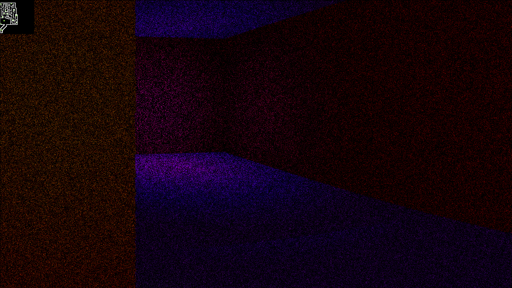

**This project is contained entirely within one shader.**

It's a small maze game with LiDAR graphics, objects to collect, and movement with collisions, but all of the logic is executed entirely on the GPU.

## Installation

If you're on x64 Linux, there's an archive with a binary and assets available in the latest release.

Otherwise, install Raylib from their [GitHub](https://github.com/raysan5/raylib/releases/latest) or their [website](https://raylib.com).
Then, clone the repository by clicking Code and downloading then extracting the .zip, by running `git clone https://github.com/dora-explora/shadergame.git`, or by running `gh repo clone dora-explora/shadergame` if you have the GitHub CLI.

Then, install a C compiler. [GNU Make](https://www.gnu.org/software/make/) is already supported, and it can be installed through [MinGW](https://www.mingw-w64.org/) on Windows, or [XCode command line tools](https://developer.apple.com/documentation/xcode/installing-the-command-line-tools) or [Homebrew](https://brew.sh/) on MacOS. You can also use any other C compiler, like [Visual Studio's build tools](https://learn.microsoft.com/en-us/cpp/build/walkthrough-compile-a-c-program-on-the-command-line?view=msvc-170). Make and GCC are usually installed on Linux by default (or included in a common build tools package).

With Make, run `make run` in a terminal within the folder to begin. Otherwise, compile the code with raylib included as a library and run the executable (usually build/shadergame) to begin.

## Usage

Once you click into the window, you can move forward and backward with W/S or ↑/↓, and you can look around with A/D or ←/→ (or moving the mouse).

There's a map at the top left showing a maze. You start at the bottom left of it, and your goal is to navigate and collect all **13** of the coins scattered around. They're highlighted in green on the map, but they may be hard to see so look close. Once you see their reflections on the floor/walls and walk over them, they'll disappear.

## Design

This entire project was made within a **GLSL shader**, which is absolutely stateless. This means that, outside of the pixels of the last frame, there is no concept of time or memory from one frame to the next. But, through clever use of an on-screen minimap that also acts as the real map which each pixel cites to render. 

This also means that every pixel runs the exact same program every frame. The only difference is the parameters: the pixel's position, every pixel of the last frame, and one pixel whose color reflects the state of the input keys. Through lots and lots of branching, each pixel independently chooses which color to be each frame, making the illusion of objects, motion, continuity, and a position in a world where there is none. This means, for example, that when a coin disappears after you walk over it, that means that a pixel that was previously blue to represent a coin looked up the player's position, checked if it overlapped with its position, and *decided to turn black*.

GLSL provides no random functions, so every "random" dot in the scene is actually noise made from floating point inaccuracies. I got this concept from [the book of shaders](https://thebookofshaders.com/10/), which is a great resource if you want to learn shader programming yourself.
